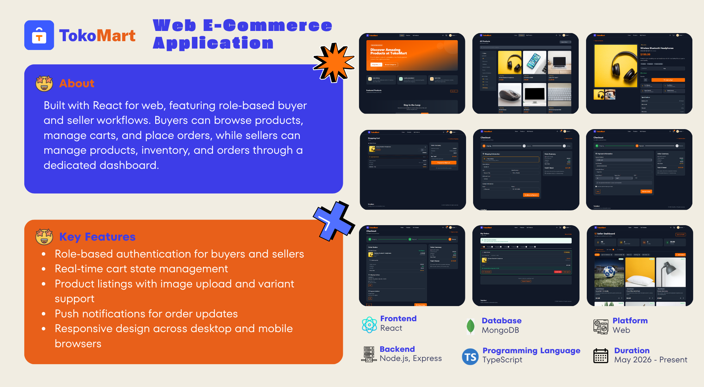
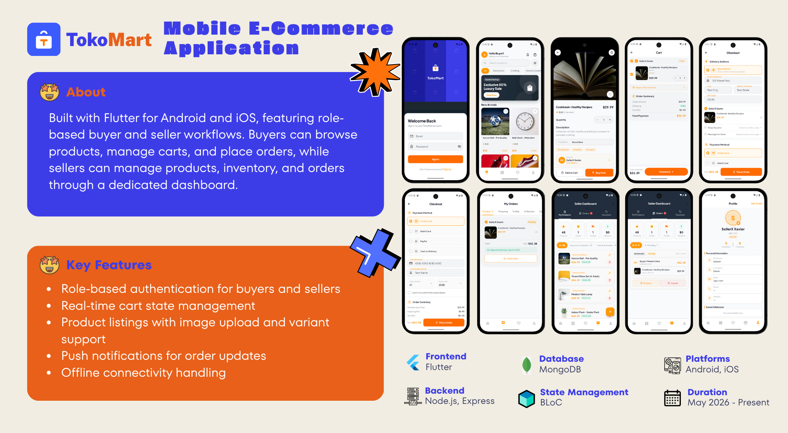

<div align="center">

# TokoMart

A multi-seller shopping app with a React web frontend, Flutter mobile app, and Express/MongoDB backend.




</div>

TokoMart supports product discovery, seller-managed catalogs, multi-seller checkout, order fulfillment, and seller-approved refunds for delivered items. Stripe development and verification use **test mode only**.

The features below describe the current implementation. **Implemented, tested, enabled, and deployed are separate states.** Checkout and refund behavior depends on matching backend and client configuration; this README does not confirm which flags are enabled on a hosted environment.

## Contents

- [Implemented features](#implemented-features)
- [Payment and order rules](#payment-and-order-rules)
- [Technology and project structure](#technology-and-project-structure)
- [Local setup](#local-setup)
- [API documentation](#api-documentation)
- [Checks and verification](#checks-and-verification)
- [Deployment and recovery](#deployment-and-recovery)
- [Troubleshooting](#troubleshooting)
- [Documentation](#documentation)

## Implemented features

### Accounts and profiles

- JWT signup, login, session handling, and authenticated API access.
- Profile editing, avatar uploads, saved shipping addresses, and saved payment-card management.
- Buyer and seller navigation, public user profiles, and follow/unfollow functionality.

### Products and shopping

- Product browsing, search, category filters, sorting, and pagination.
- Product details with pricing, discounts, images, stock, and variant selection.
- Seller product creation, editing, and deletion, including variants and shipping configuration.
- Buyer cart item selection and quantity changes, with server-backed cart persistence and account isolation.
- Seller coupons and checkout validation.
- Mobile wishlist selection. This currently lives in the wishlist BLoC; it is not a server-synced wishlist.

### Checkout and payments

- Multi-seller checkout with separate seller orders, delivery choices, discounts, tax, and shipping breakdowns.
- New and saved Stripe cards, default-card management, and cash on delivery.
- Optional authorization at checkout followed by capture when the seller accepts and starts preparing the order.
- Pending-order cancellation, authorization release, acceptance deadlines, and recovery workers.
- Separate compatibility handling for existing captured payments.

### Orders and seller tools

- Buyer order history and order details; seller order lists, details, and fulfillment actions.
- Fulfillment stages: `pending → preparing → processing → shipped → delivered`.
- Buyer confirmation of receipt and automatic completion of eligible shipped orders.
- Buyer and seller cancellation of eligible pending orders. Seller cancellation requires an explanation.
- Refund status and quantity badges on affected order items, plus refunded amounts and net seller revenue.
- Seller refund history on the order detail view and dedicated Return/Refund views.

### Delivered-item refunds

Available on **web and mobile**, backed by shared API and payment services:

- Buyers select whole item units and describe an issue within seven days of recorded delivery.
- Sellers approve the submitted quote or reject it with an explanation. Approval starts payment processing immediately; a physical return is not required.
- Quotes use the original discounted item amounts and allocated original tax, not current catalog prices.
- Shipping is included once with the final paid-unit selection only when the current request and all earlier confirmed refunds establish seller fault. Partial selections and `other` requests exclude shipping.
- Change of mind is not accepted after delivery; cancellation for change of mind belongs to the pending-order stage.
- Buyer Return/Refund lists seller-approved requests that are processing, need payment review, or have completed. Waiting and rejected requests remain in the order's history.
- Seller requests are grouped into **In Progress**, **Approved**, and **Rejected**, with additional results loaded on scroll.
- Fully refunded orders leave the buyer's Complete tab; their fulfillment record remains delivered. Partially refunded orders remain in Complete with item-level refund marks.
- Durable operations, stable idempotency keys, reservations, webhooks, and reconciliation protect against repeated decisions, retries, and crashes.

Delivered refunds currently support captured Stripe card payments. Physical returns, photos, appeals, automatic seller-decision timeouts, and delivered COD/PayPal refunds are outside this implementation. Historical orders without trustworthy delivery dates or payment allocations are ineligible.

### Reviews and usability

- Product ratings and written reviews associated with delivered purchases.
- Light/dark themes, responsive web layouts, network feedback, and retry/error states.
- Refund forms show product context, readable deadlines, refund breakdowns, and approval confirmation.

## Payment and order rules

### Match the checkout flow across platforms

The defaults retain the legacy card flow. To use authorization followed by seller capture, configure all participating clients consistently:

- Backend: `CHECKOUT_FLOW=manual_capture`.
- Web: `VITE_CHECKOUT_FLOW=manual_capture` before starting/building the app.
- Mobile: `--dart-define=CHECKOUT_FLOW=manual_capture` at run/build time.
- Seller visibility: `SELLER_SEES_MANUAL_CAPTURE=true` on the backend.

For this flow, an uncaptured payment appearing in Stripe after checkout is an authorization, not a completed charge. Seller acceptance starts capture and preparation. The acceptance deadline is normally 24 hours, or earlier when the card authorization expires, with a safety margin. Expired orders are handled by the acceptance scanner.

Eligible pending cancellations release the hold and restore reserved inventory, sold counters, and coupon usage once. Cancellation is refused after seller acceptance has claimed the order. Already-captured legacy payments use a separate reconciliation/refund path; they must not be charged again.

See [payment recovery](docs/payment-recovery.md) and [legacy payment reconciliation](docs/legacy-payment-reconciliation.md) for supported payment states and failure handling.

### Delivered refunds are separately gated

`DELIVERED_REFUNDS_ENABLED=true` on the backend enables new delivered-refund requests and seller decisions; it is **off by default**. Reads and reconciliation of previously approved requests remain available when the flag is off.

An approved refund is not necessarily settled. Only confirmed refunded amounts reduce seller revenue. Delivered refunds do not restore inventory, sold counters, or coupon usage, and do not change delivery back to an earlier stage. Previously submitted item-only quotes keep their original amounts rather than receiving an automatic shipping top-up.

## Technology and project structure

The repository currently declares:

- **Web:** React 19, TypeScript 6, Vite 8, React Router 7, Tailwind CSS 3, Context, Lucide, and Stripe.js.
- **Mobile:** Flutter/Dart, BLoC, GoRouter, Dio, SharedPreferences, and `flutter_stripe`. The checked-in lockfile requires Flutter **3.44+** and Dart **3.13+**.
- **Backend:** Node.js, TypeScript 5, Express 4, Mongoose 8, MongoDB, Stripe, JWT, bcryptjs, and Cloudinary/Multer uploads.
- **Verification:** Vitest, Flutter unit/widget tests, and database integration tests. Playwright and Patrol automation are maintained separately by the owner.

```text
shopping-app-automation/
├── backend/                 Express API, models, payment workers, and backend tests
├── frontend/                React web application and unit tests
├── frontend-mobile/         Flutter application and unit/widget tests
├── e2e-testing/             Owner-maintained Playwright automation
├── docs/                    Deployment, payment, recovery, and verification guides
├── AGENTS.md                Repository rules for coding agents
└── README.md
```

## Local setup

The documented local setup uses these addresses after starting the apps:

- Web app: [http://localhost:5173](http://localhost:5173)
- Backend API: [http://localhost:5001/api](http://localhost:5001/api)
- Backend health: [http://localhost:5001/health](http://localhost:5001/health)
- Android emulator API: `http://10.0.2.2:5001/api`

These match the [local verification setup](docs/local-payment-verification.md) and the mobile debug launch configuration. The example environment files still default to backend port 5000; set `PORT=5001` in `backend/.env` and `VITE_API_BASE_URL=http://localhost:5001/api` in `frontend/.env` to use the addresses above. Keep `CORS_ORIGIN=http://localhost:5173` for the web app. These are startup addresses, not a check that the servers are currently running.

### Prerequisites

- Node.js **22.12+ on the Node 22 line** and npm, compatible with the current build/test tooling.
- A MongoDB **replica set** for transaction-based checkout, cancellation, and refund flows. Use an existing local replica set or an Atlas deployment.
- A Stripe test account and publishable/secret test keys for card flows.
- Cloudinary configuration for product/avatar uploads.
- A compatible Flutter SDK and Android/iOS development tooling for mobile work.

Use separate development and test databases. Do not point seeds or integration tests at data you want to retain. The examples below do not create MongoDB containers or change system settings.

Run each setup block from the repository root in its own terminal. Copy `.env.example` only for a first setup; if an `.env` already exists, edit it rather than overwriting it.

### Backend

```powershell
cd backend
npm ci --legacy-peer-deps
Copy-Item .env.example .env
```

Configure `backend/.env` privately using the example as a guide:

- `MONGODB_URI`: your intended development database on a replica set.
- `JWT_SECRET`: a private signing secret.
- `STRIPE_SECRET_KEY` and `STRIPE_WEBHOOK_SECRET`: test credentials and the signing secret for the matching webhook endpoint.
- `CLOUDINARY_CLOUD_NAME`, `CLOUDINARY_API_KEY`, and `CLOUDINARY_API_SECRET`: upload configuration.
- `PORT`, `CORS_ORIGIN`, and the checkout/refund flags for your chosen environment.

For an existing local replica set named `rs0` exposed on port 27018, an example development URI is:

```text
mongodb://127.0.0.1:27018/tokomart_dev?replicaSet=rs0&directConnection=true
```

Use your actual replica-set name, host, and intended database. Keep secret keys, credentials, and connection strings out of commits and client configuration.

After configuring the environment:

```powershell
npm run dev
```

With `PORT=5001`, the API is [http://localhost:5001/api](http://localhost:5001/api), with a process health endpoint at [http://localhost:5001/health](http://localhost:5001/health). The web app runs separately on port 5173. Run `npm run seed` only if you deliberately want sample data in the configured database, or create accounts through Sign Up.

The backend starts draft cleanup, seller-acceptance scanning, payment-operation recovery, Stripe inbox processing, and the order-completion job. See the [rollout guide](docs/payment-rollout.md) before changing job ownership or hosting topology.

### Web

```powershell
cd frontend
npm ci
Copy-Item .env.example .env
```

Set public client configuration in `frontend/.env`:

- `VITE_API_BASE_URL`: `http://localhost:5001/api` for the documented local backend.
- `VITE_STRIPE_PUBLISHABLE_KEY`: the Stripe test publishable key.
- `VITE_CHECKOUT_FLOW`: match the backend flow.

```powershell
npm run dev
```

Open [http://localhost:5173](http://localhost:5173). Every `VITE_` value is exposed in the browser bundle; backend secrets do not belong there. Rebuild hosted web deployments after changing these values.

### Mobile

```powershell
cd frontend-mobile
flutter pub get
Copy-Item .env.example .env
```

Set `STRIPE_PUBLISHABLE_KEY` in the mobile `.env`. This file is bundled into the app and must contain public configuration only.

For an Android emulator using the documented local backend:

```powershell
flutter run --dart-define=API_BASE_URL=http://10.0.2.2:5001/api
```

When the backend uses manual capture, include the matching flag:

```powershell
flutter run --dart-define=API_BASE_URL=http://10.0.2.2:5001/api --dart-define=CHECKOUT_FLOW=manual_capture
```

For an iOS simulator, use `http://127.0.0.1:5001/api`. A physical device needs a reachable LAN or hosted API address; its `localhost` refers to the device itself.

Release builds require an explicit hosted HTTPS API URL ending in `/api`. The mobile API URL and checkout flow are build-time settings, not values read from the bundled `.env`.

## API documentation

With the backend running in development mode:

- [Swagger UI](http://localhost:5001/api-docs/)
- [OpenAPI JSON](http://localhost:5001/api-docs.json)
- [Backend API guide](backend/README.md#api-documentation)

Adjust port 5001 when using a different backend port. API documentation is disabled when `NODE_ENV=production`. Login returns a token; Swagger's Authorize dialog accepts that token alone and supplies the Bearer prefix.

API groups include authentication, products, carts, orders, seller fulfillment/refunds, reviews, users/follows, coupons, payments, and checkout sessions. Delivered-refund endpoints expose eligibility, buyer history and requests, and seller decisions. Consult OpenAPI for request schemas and access requirements.

## Checks and verification

The following commands are available for an explicitly requested full verification. For focused changes, run the relevant type/lint checks and the changed test file, following [AGENTS.md](AGENTS.md). Do not infer a current pass from historical results.

Backend, from `backend/`:

```powershell
npx tsc --noEmit
npm test
npm run test:contracts
```

Database integration tests must target a replica-set database whose name ends in `_test`, normally on port 27018:

```powershell
$env:TEST_MONGODB_URI='mongodb://127.0.0.1:27018/tokomart_integration_test?replicaSet=rs0&directConnection=true'
npm run test:integration
```

Web, from `frontend/`:

```powershell
npx tsc -b
npm run lint
npm test
npm run build
```

Mobile, from `frontend-mobile/`:

```powershell
flutter analyze
flutter test
```

The delivered-refund review on **2026-10-23**, at commit `5a4b36c`, recorded:

- Backend: **272 unit**, **33 contract**, and **414 integration** tests passed.
- Web: **212 tests**, TypeScript, and ESLint passed.
- Mobile: **343 tests** and analysis passed, with **five existing skips**.

These results apply to that reviewed revision. The README update itself does not rerun those suites. The actual Stripe test-mode check of the shipping-refund amendment, manual browser/device acceptance of the latest screens, and hosted enablement checks remain separate work. See [local verification evidence](docs/local-payment-verification.md).

Playwright and Patrol files and runs are owner-maintained. They were intentionally excluded from this documentation update and the cited refund review.

## Deployment and recovery

Use the [deployment guide](docs/deployment.md) and [payment rollout runbook](docs/payment-rollout.md) for hosting roots, public URLs, build settings, CORS, Stripe webhooks, worker requirements, monitoring, and rollback.

- Deploy the backend, web, and mobile builds with compatible checkout settings and refund response handling.
- Keep payment recovery running for operations already approved, even when disabling new refund requests.
- A process health check is not a guarantee of database readiness or payment settlement.
- Verify the deployed environment separately; local implementation and tests do not establish hosted readiness.

## Troubleshooting

- **Port already in use:** check whether the app is already running and reuse the correct URL. Do not start duplicate instances or terminate an unfamiliar process. Change a port only when intentionally configuring a separate stack, and update its clients accordingly.
- **Mobile and web show different data:** compare their configured backend URLs, selected accounts, and backend database. Do not assume an emulator's `localhost` is your development machine.
- **Frontend still calls localhost after deployment:** update the public API URL and rebuild/redeploy the client. Vite and mobile build-time configuration do not change an existing bundle.
- **MongoDB transactions fail:** confirm the configured database belongs to a replica set. An Atlas database and a local Docker database are separate deployments.
- **CORS errors:** use the exact frontend origin in backend configuration, including its scheme and port and without an API path.
- **Payment is uncaptured:** in manual-capture checkout this is expected before seller acceptance. Check order/payment status and worker activity rather than creating a replacement charge.
- **Refund says processing or needs review:** retain its original request and operation key, and follow the [recovery guide](docs/payment-recovery.md). Bank posting can take longer than confirmed provider settlement.

## Documentation

- [Feature documentation index](docs/features.md) — `docs/features.md`
- [Backend API and setup](backend/README.md) — `backend/README.md`
- [Mobile architecture and setup](frontend-mobile/README.md) — `frontend-mobile/README.md`
- [Deployment](docs/deployment.md) — `docs/deployment.md`
- [Payment rollout and rollback](docs/payment-rollout.md) — `docs/payment-rollout.md`
- [Payment and cancellation recovery](docs/payment-recovery.md) — `docs/payment-recovery.md`
- [Legacy captured-payment reconciliation](docs/legacy-payment-reconciliation.md) — `docs/legacy-payment-reconciliation.md`
- [Backend payment verification](docs/backend-payment-verification.md) — `docs/backend-payment-verification.md`
- [Local verification evidence](docs/local-payment-verification.md) — `docs/local-payment-verification.md`
- [Delivered-refund handoff](docs/delivered-refunds-handoff.md) — `docs/delivered-refunds-handoff.md`. Includes historical entries; use its latest updates and verify against code.
- [Coding-agent and documentation rules](AGENTS.md) — `AGENTS.md`

The [feature documentation index](docs/features.md) links to separate files under `docs/features/<area>/<feature-name>.md` and is being populated incrementally. It currently includes the order-notification proposal and distinguishes existing behavior from planned work. The feature summary above is an overview, not a substitute for verified per-feature documentation.
